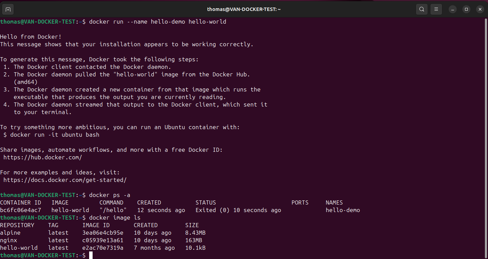

# 01 — Container Fundamentals

## Overview

A container packages an application with its required userspace dependencies and runs it as an isolated process or group of processes. Linux containers share the host's Linux kernel rather than booting a separate guest kernel. Isolation uses namespaces; resource accounting and limits use control groups (cgroups).

## Containers versus virtual machines

| Virtual machine | Container |
|---|---|
| Runs a guest operating system and kernel | Shares host kernel for Linux containers |
| Managed through a hypervisor | Managed through a container runtime |
| Usually larger image and longer boot time | Often smaller and starts quickly |
| Strong guest OS boundary | Process-level isolation; security still requires configuration |

A Linux host can run Ubuntu, Alpine, or other Linux-distribution userspaces as containers when compatible with the host kernel. It cannot directly run Windows containers with a Linux kernel. Docker Desktop can run Linux containers on Windows using a Linux virtualization backend.

## Image versus container

- **Image:** packaged, layered, largely read-only template (for example, `nginx:stable`).
- **Container:** an instance created from an image with runtime configuration and a writable layer.
- **Registry:** remote service storing and distributing images, such as Docker Hub or GitHub Container Registry.

One image can be used to create multiple containers. Images are typically built from Dockerfiles and can be pushed to registries.

## Why Docker?

Repeatable packaging, environment consistency, faster local experimentation, application isolation, and integration with development and delivery pipelines. Portability still depends on compatible CPU architecture, kernel/runtime features, networking, configuration, and external services.

## Quick exercise

```bash
docker run --name hello-demo hello-world
docker ps -a
docker image ls
```



**Successful `hello-world` output, followed by image and stopped-container listings.**

## Summary

A container is not a small VM: it runs processes with OS-level isolation and shares the host kernel. An image is the template; a container is the runtime instance.

Reference: https://docs.docker.com/get-started/docker-concepts/the-basics/what-is-a-container/
