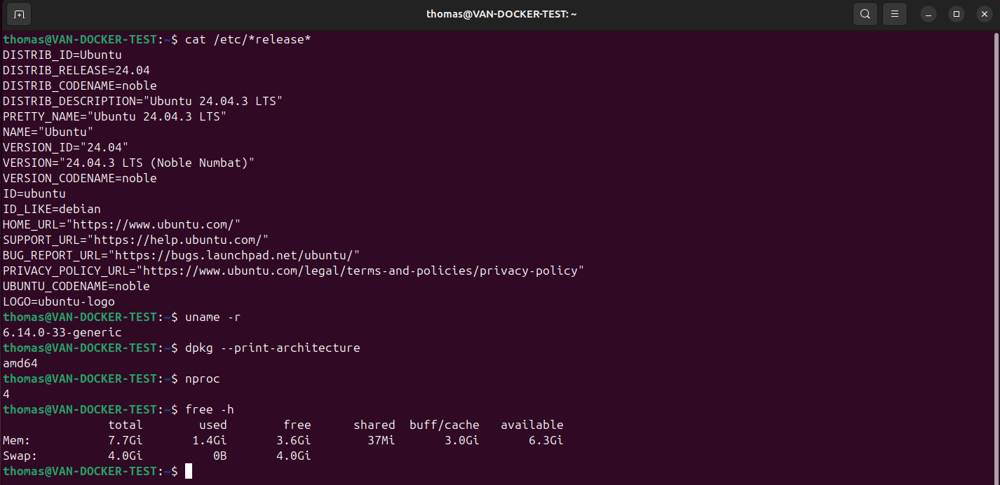
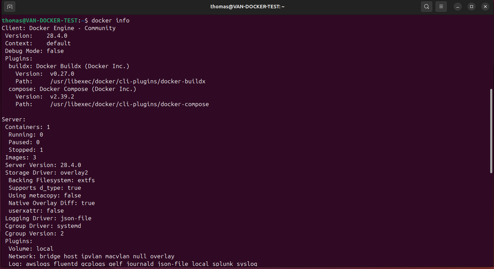

# 02 — Docker Architecture

## Components

Here is an overview of Docker components:

- **Docker CLI (`docker`):** client used to issue commands.
- **Docker daemon (`dockerd`):** manages images, containers, networks, and volumes and exposes an API.
- **containerd:** container lifecycle and runtime management.
- **runc:** OCI-compatible low-level runtime that creates containers using Linux kernel facilities.
- **Docker Buildx / BuildKit:** modern image-building tooling.

Conceptual flow: `docker CLI → dockerd → containerd → runc → Linux kernel` (simplified).

## Kernel isolation and resources

Namespaces provide separate views of processes, networking, mounts, etc. Cgroups account for and limit resources. For example:

```bash
docker run --rm --cpus=0.5 --memory=128m alpine sh -c 'echo Resource-limited container'
```

This applies limits to the container; it does not guarantee sustained performance.

## Inspect the running engine

```bash
docker version
docker info
docker context ls
```





*Selected OS and VMWare image information as well as output from `docker info` lines showing client/server, runtime, cgroups, and storage driver.*

## Security notes

- Docker requires elevated privileges to manage containers, images, and networks. Users in the `docker` group effectively have root-level access to the host.
- Avoid exposing the Docker daemon directly over an unsecured network connection.
- Remote Docker administration should use secure connections, such as SSH or TLS.
- Docker also supports *rootless mode*, which allows the daemon and containers to run without root privileges. This lab uses the standard Docker configuration rather than rootless mode.

## Storage backend note

This lab previously reported `overlay2` on Engine 28.4.0. Fresh Engine 29+ installations default to the containerd image store and snapshotters; do not assume all hosts have the same on-disk layout.

References: https://docs.docker.com/engine/security/ ; https://docs.docker.com/engine/storage/containerd/
