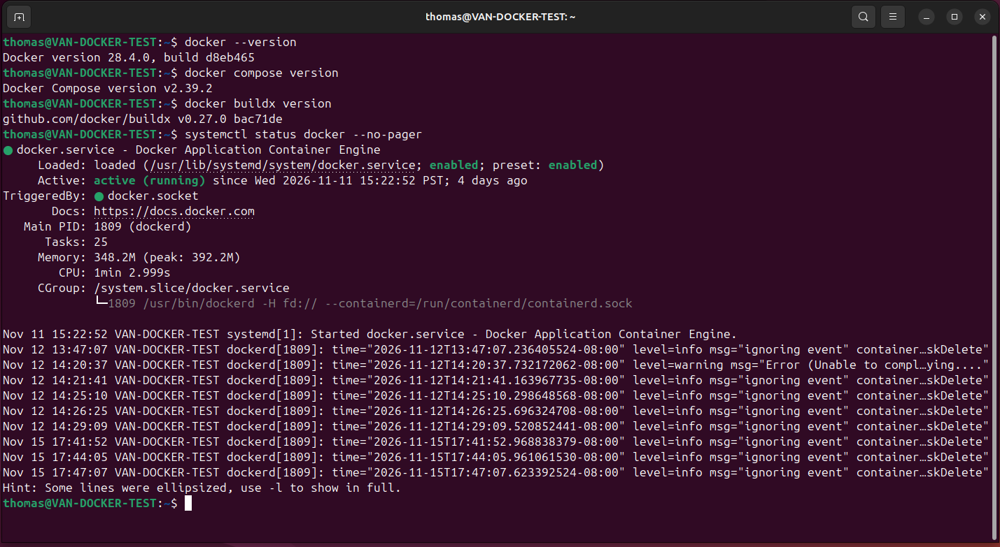
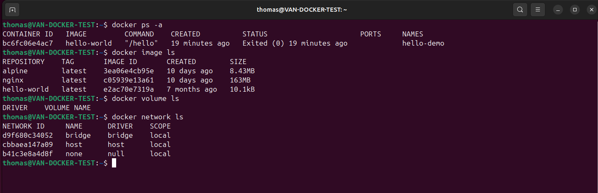

# 03 — Lab Environment

## Configuration

| Item | Configuration |
|---|---|
| Hostname | `VAN-DOCKER-TEST` |
| OS | Ubuntu 24.04.3 LTS |
| Architecture | x86_64 |
| CPU / memory | 4 vCPUs / 8 GiB |
| Docker Engine | 28.4.0 Community |
| Docker Compose | v2.39.2 |
| Buildx | v0.27.0 |
| Storage driver | overlay2 |
| Cgroup | v2, systemd driver |


## Installation and validation

Docker was installed before this documentation project; the installation is **not** being redone. Refer to [Docker's Ubuntu installation guide](https://docs.docker.com/engine/install/ubuntu/) 

```bash
cat /etc/os-release
uname -r
dpkg --print-architecture
nproc
free -h

docker --version
docker compose version
docker buildx version
systemctl status docker --no-pager
docker info
```



*OS version and Docker/Compose versions. Output from `systemctl status docker` showing an active daemon (if active).*

## Lab reset

Previous training containers and images were removed so exercises could be recreated and documented. Volume and network were verified, as shown in the screenshot above.

```bash
docker ps -a
docker image ls
docker volume ls
docker network ls
```

## Ubuntu administration relevant to Docker

- `systemctl status docker` — inspect service state.
- `journalctl -u docker --no-pager -n 50` — review daemon logs.
- `ip addr` — inspect host interfaces.
- `ss -lnt` — review listening TCP sockets.
- `df -h` — check disk capacity.

