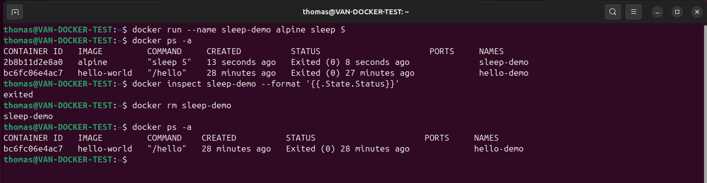
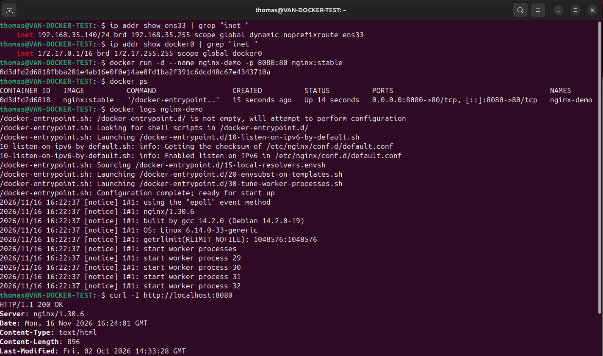
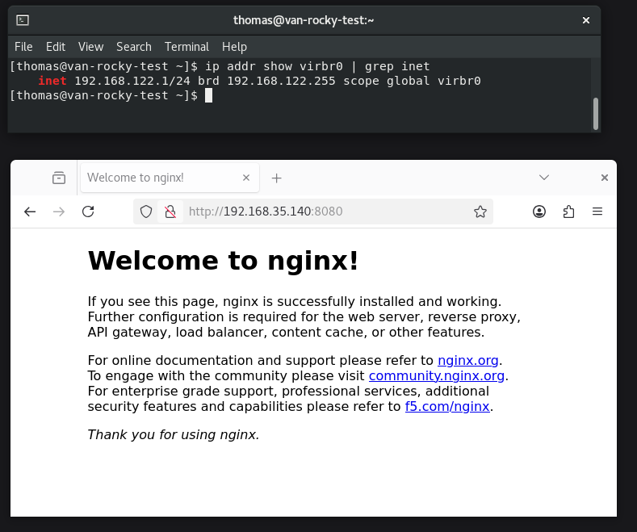
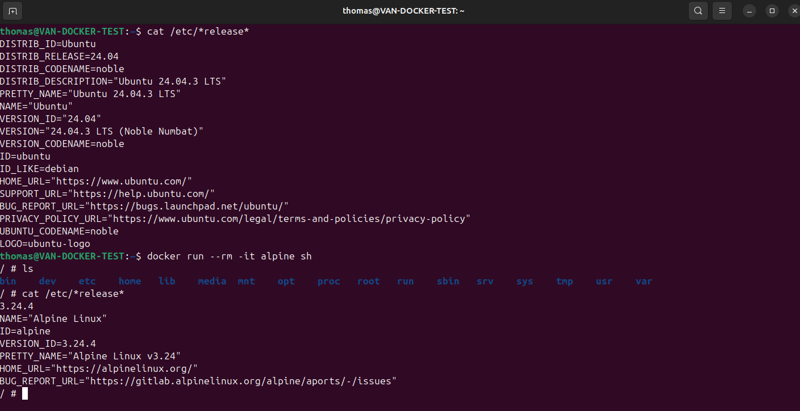

# 04 — Container Management

## Common commands

| Command | Purpose |
|---|---|
| `docker pull alpine` | Download image without starting it |
| `docker image ls` | List local images |
| `docker ps` | List running containers |
| `docker ps -a` | Include stopped containers |
| `docker run ...` | Create and start a container |
| `docker start NAME` / `docker stop NAME` | Start/stop an existing container |
| `docker rm NAME` | Remove stopped container |
| `docker rmi IMAGE` | Remove an image if not in use |
| `docker logs NAME` | View container output |
| `docker inspect NAME` | Inspect detailed JSON configuration |
| `docker exec -it NAME sh` | Start a shell in a running container |

## Exercise A — short-lived process

```bash
docker run --name sleep-demo alpine sleep 5
docker ps -a
docker inspect sleep-demo --format '{{.State.Status}}'
docker rm sleep-demo
```

A container exits when its main process completes. An exited container remains listed until removed.


*`sleep-demo` with `Exited (0)` status.*

## Exercise B — detached Nginx service

```bash
docker run -d --name nginx-demo -p 8080:80 nginx:stable
docker ps
docker logs nginx-demo
curl -I http://localhost:8080

docker stop nginx-demo
docker rm nginx-demo
```


*IP address output from the VM host where Docker is installed. `-d` runs in the background. `-p 8080:80` publishes host port 8080 to container port 80. On a remote VM, browse to its reachable host address instead of your workstation's `localhost`.*

  
*Browser response from Nginx when accessed from remote Rocky Linux VM*

## Exercise C - interactive and attached mode

```bash
docker run --rm -it alpine sh
```


*Alpine Linux shell within a container running on Ubuntu host. `-i` keeps standard input open; `-t` allocates a pseudo-terminal.*

**NOTE:** `docker attach` connects to the main process streams; `docker exec` starts a new process in a running container.*

## Cleanup

```bash
docker system df
```

`docker system prune` can delete stopped containers and unused resources. Use deliberately; do not treat cleanup commands as harmless.
