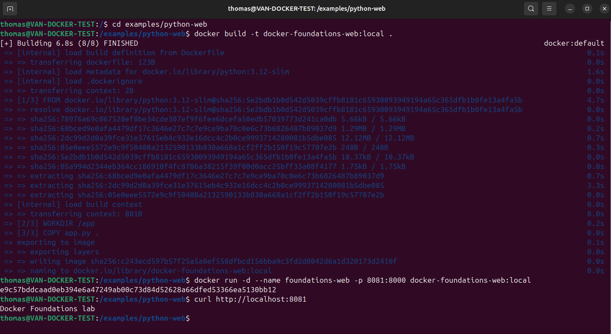
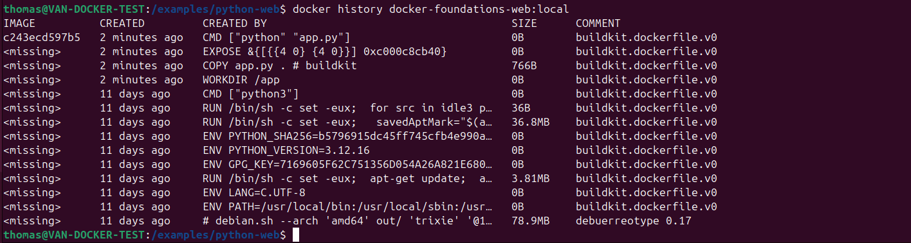
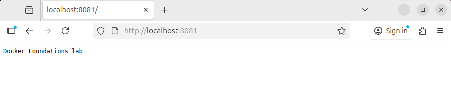
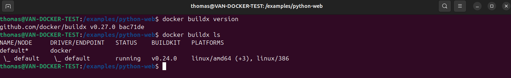

# 05 — Docker Images and Dockerfiles

## Concepts

A Dockerfile defines image-building instructions. Docker builds an image from a base image and additional layers. The container receives a writable layer at runtime. It is better to use explicit, supported image tags over relying on `latest` for repeatable builds.

## Minimal original example

The repository includes a small Python HTTP example in [`../examples/python-web/`](../examples/python-web/). 

**Dockerfile** 

```dockerfile
FROM python:3.12-slim
WORKDIR /app
COPY app.py .
EXPOSE 8000
CMD ["python", "app.py"]
```

Build and run:

```bash
cd examples/python-web
docker build -t docker-foundations-web:local .
docker run -d --name foundations-web -p 8081:8000 docker-foundations-web:local
curl http://localhost:8081
docker history docker-foundations-web:local
docker stop foundations-web && docker rm foundations-web
```
  
  
  
  


*Successful build output and `docker image ls`. Successful browser output from running custom image*

## CMD versus ENTRYPOINT

- `CMD` specifies a default command or default arguments and can be replaced by arguments to `docker run`.
- `ENTRYPOINT` specifies the executable; arguments to `docker run` are appended when using exec-form ENTRYPOINT.
- With both, `CMD` commonly supplies default arguments to `ENTRYPOINT`.

Example:

```dockerfile
FROM alpine:3.21
ENTRYPOINT ["sleep"]
CMD ["5"]
```

`docker run IMAGE 10` runs `sleep 10`; `docker run --entrypoint sh IMAGE` replaces the entrypoint. Using this format allows Docker to run the command directly and handle stop signals more reliably.

## BuildKit / Buildx

BuildKit supports caching, build secrets, and multi-platform workflows. Do not put secrets in `ARG`, `ENV`, source files, or image layers. This foundational repo demonstrates ordinary `docker build`; advanced Buildx experiments can be added later.

```bash
docker buildx version
docker buildx ls
```

References: https://docs.docker.com/build/ ; https://docs.docker.com/reference/dockerfile/
