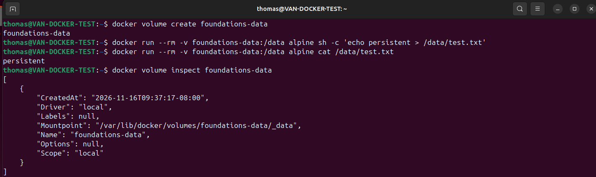
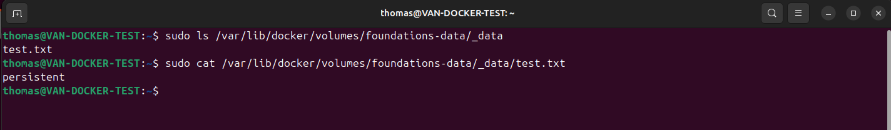
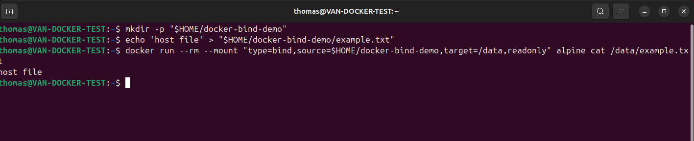

# 06 — Docker Storage

## Writable layer versus persistent data

A container's writable layer is not an appropriate place for durable application data. Docker volumes and bind mounts allow data to persist beyond the lifetime of an individual container.

| Mechanism | Typical use |
|---|---|
| Container writable layer | Temporary runtime changes |
| Named volume | Docker-managed persistent application data |
| Bind mount | Explicit host path shared with container |

## Exercise A — named volume

```bash
docker volume create foundations-data
docker run --rm -v foundations-data:/data alpine sh -c 'echo persistent > /data/test.txt'
docker run --rm -v foundations-data:/data alpine cat /data/test.txt
docker volume inspect foundations-data
```

The second container should read the file created by the first, even though the first container was removed.

  
  

*Named volume listing and successful read of `persistent`.*

## Exercise B — bind mount

```bash
mkdir -p "$HOME/docker-bind-demo"
echo 'host file' > "$HOME/docker-bind-demo/example.txt"
docker run --rm --mount "type=bind,source=$HOME/docker-bind-demo,target=/data,readonly" alpine cat /data/example.txt
```
  
*Host file and matching container output.*

## Cleanup

```bash
docker volume rm foundations-data
```

Do not delete volumes containing required data. `docker volume prune -a` can permanently remove unused volumes.

## Storage implementation

This lab uses `overlay2`. On newer fresh Engine installations, containerd snapshotters may be used instead. Storage drivers/snapshotters implement image layer management; volumes solve a different persistence problem.

Reference: https://docs.docker.com/engine/storage/
