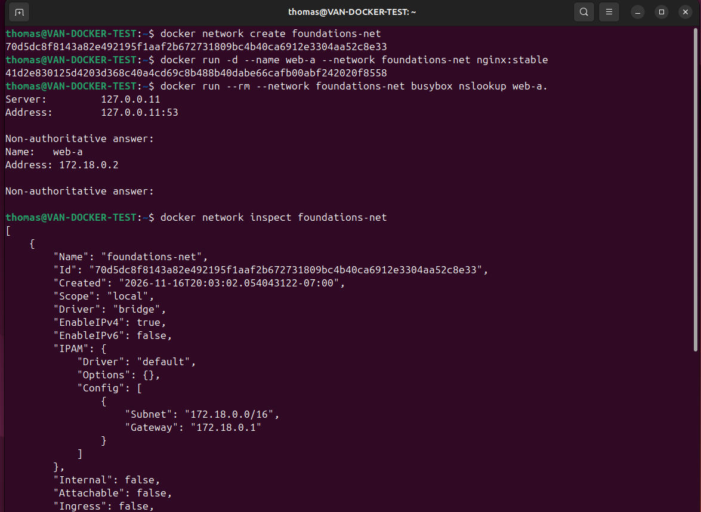
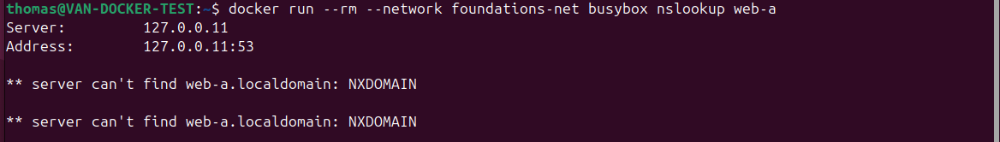
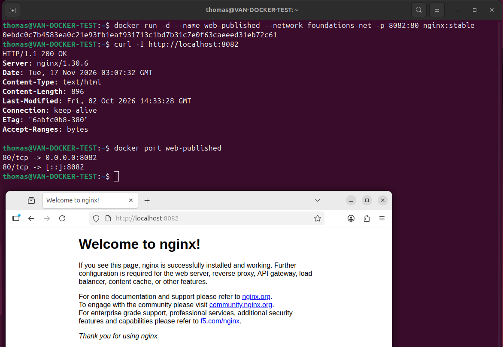

# 07 — Docker Networking

## Network modes

Here are the default network modes in Docker:

- **bridge:** default network driver for standalone Linux containers; user-defined bridges support container-name DNS resolution.
- **host:** container shares the host's network namespace (Linux Engine behavior).
- **none:** no normal external network connectivity.

Publishing a port (`-p HOST:CONTAINER`) makes a container service reachable through the Docker host. It is distinct from communication between containers on the same network.

## Exercise A — user-defined bridge and DNS

```bash
docker network create foundations-net
docker run -d --name web-a --network foundations-net nginx:stable
docker run --rm --network foundations-net busybox nslookup web-a
docker network inspect foundations-net
```

Docker's embedded DNS on user-defined networks allows containers to resolve other containers by name. The internal resolver commonly appears as `127.0.0.11`.

  
  

*`nslookup web-a` and network inspection output. In the first screenshot, a dot is added after `web-a` so that resolver is not searching for `web-a.localdomain*

## Exercise B — published port

```bash
docker run -d --name web-published --network foundations-net -p 8082:80 nginx:stable
curl -I http://localhost:8082
docker port web-published
```

  
*Published-port mapping and HTTP response.*

## Cleanup

```bash
docker rm -f web-a web-published
docker network rm foundations-net
```

## Notes

- Default bridge networking differs from user-defined bridges, especially for DNS.
- Port publishing may expose services beyond localhost; bind explicitly to `127.0.0.1` if local-only access is desired, for example `-p 127.0.0.1:8082:80`.
- Containers have separate network namespaces and connect through virtual networking devices.

Reference: https://docs.docker.com/engine/network/
