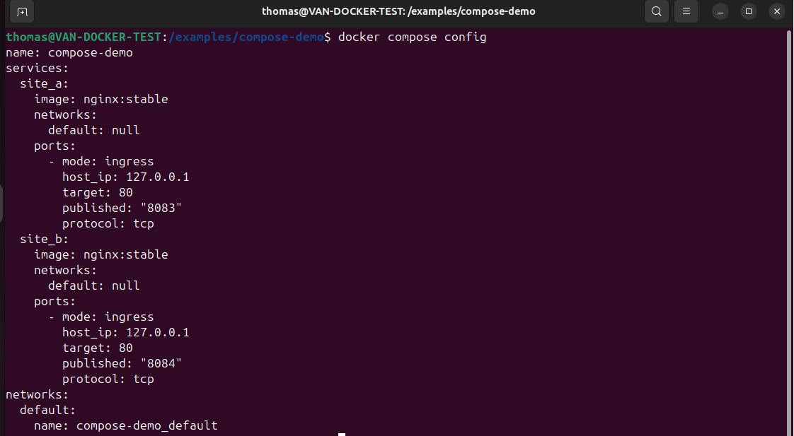
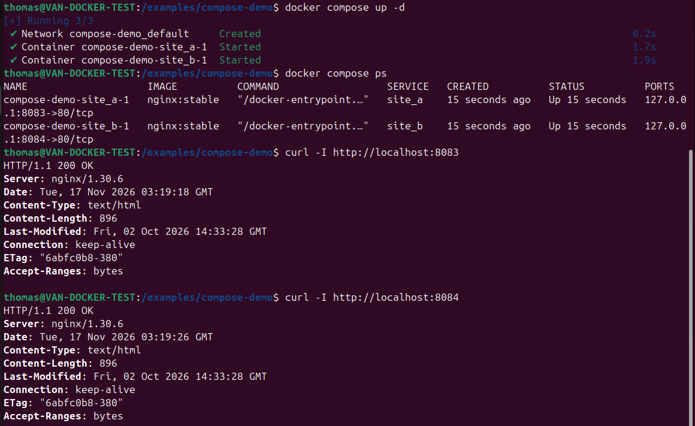
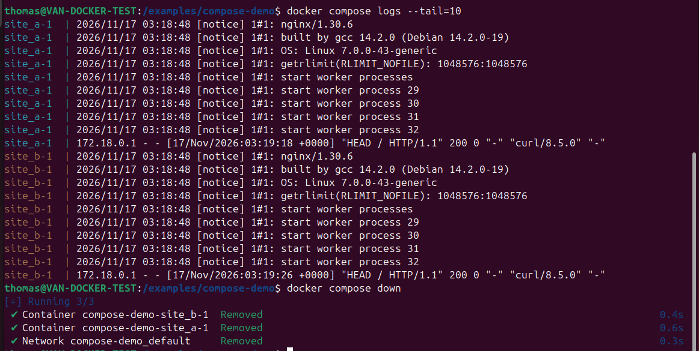

# 08 — Docker Compose

## Overview

Compose defines and manages a group of services, networks, and volumes using a YAML file. The `docker compose` CLI and Compose specification is used to implement the configuration.

## Exercise — two Nginx services

See [`../examples/compose-demo/compose.yaml`](../examples/compose-demo/compose.yaml).

```yaml
services:
  site_a:
    image: nginx:stable
    ports:
      - "127.0.0.1:8083:80"
  site_b:
    image: nginx:stable
    ports:
      - "127.0.0.1:8084:80"
```

```bash
cd examples/compose-demo
docker compose config
docker compose up -d
docker compose ps
curl -I http://localhost:8083
curl -I http://localhost:8084
docker compose logs --tail=10
docker compose down
```
  
  
  

*`docker compose ps` showing both services and their published ports. HTTP responses from both services.*

## YAML essentials

Indentation defines nesting; lists use `-`, maps use `key: value`, and comments start with `#`. Validate the file with `docker compose config` before starting services.

## Beyond this example

Compose can declare custom networks, named volumes, build contexts, environment variables, and service dependencies. An original application with multiple cooperating services is **planned**, not yet implemented.

Reference: https://docs.docker.com/reference/compose-file/
