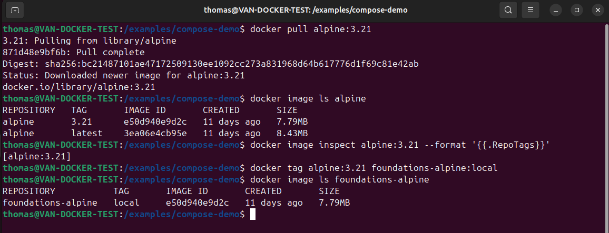

# 09 — Registries and Image Distribution

## Concepts

A registry distributes container images. Image names may include registry hostname, namespace, repository, and tag.

Example: `docker.io/library/nginx:stable`.

Common registries include Docker Hub (`docker.io`), GitHub Container Registry (`ghcr.io`), Amazon ECR, Azure Container Registry, and Google Artifact Registry. Authentication, permissions, and pull limits depend on the provider and account.

Repository versus registry:
- A repository is a collection of related image versions identified by tags.
- A registry is a service that stores and distributes container images, such as Docker Hub.

## Local exercise

```bash
docker pull alpine:3.21
docker image ls alpine
docker image inspect alpine:3.21 --format '{{.RepoTags}}'
docker tag alpine:3.21 foundations-alpine:local
docker image ls foundations-alpine
```
  

*Pull and local retagging output.*

## Pushing an image

Publishing to a remote registry requires an account, appropriate repository permissions, and authentication. Do not commit registry credentials or access tokens to GitHub. For Docker Hub, the typical workflow is `docker login`, `docker tag`, then `docker push` with an authorized namespace. This repository does not claim a successful push until performed.


Reference: https://docs.docker.com/docker-hub/repos/
