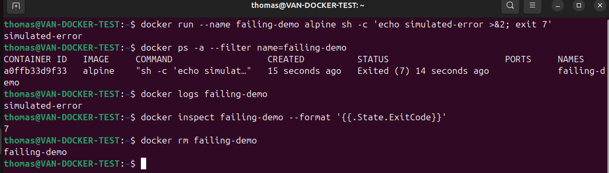
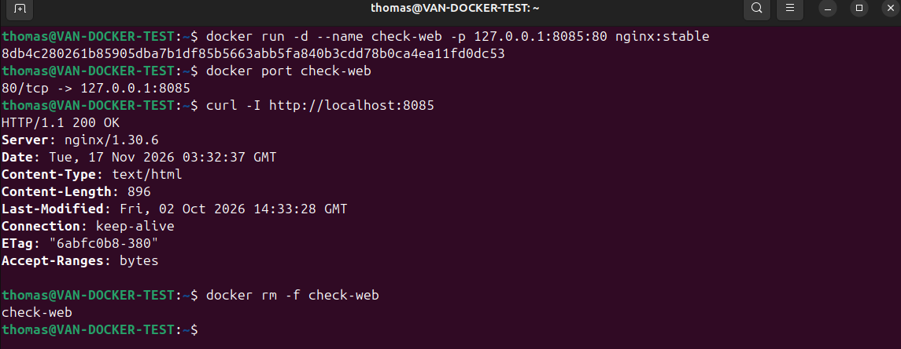

# 10 — Docker Troubleshooting

## Initial approach

1. Identify the failing container and symptom.
2. Check container state, exit code, and logs.
3. Inspect configuration, mounts, ports, and network membership.
4. Verify host service and resource availability.
5. Change one thing, retest, and record the outcome.

## Useful commands

| Command | Use |
|---|---|
| `docker ps -a` | Container status |
| `docker logs NAME` | Application output and errors |
| `docker inspect NAME` | Configuration, state, network, mounts |
| `docker stats --no-stream` | Resource usage snapshot |
| `docker exec -it NAME sh` | Inspect running container |
| `docker port NAME` | Published port mapping |
| `docker network inspect NETWORK` | Network attachments |
| `docker system df` | Docker disk usage |
| `journalctl -u docker -n 50 --no-pager` | Docker daemon logs |

## Exercise A — expected nonzero exit

```bash
docker run --name failing-demo alpine sh -c 'echo simulated-error >&2; exit 7'
docker ps -a --filter name=failing-demo
docker logs failing-demo
docker inspect failing-demo --format '{{.State.ExitCode}}'
docker rm failing-demo
```
  

*Expected exit code: `7`. This is an intentionally failing example, not a Docker daemon failure.*

## Exercise B — published port validation

```bash
docker run -d --name check-web -p 127.0.0.1:8085:80 nginx:stable
docker port check-web
curl -I http://localhost:8085
docker rm -f check-web
```

  

*Port mapping and successful HTTP header response.*

